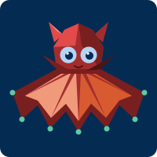
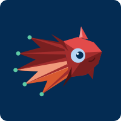
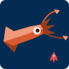

# Vampire Squid Game — Ideas & Spec

> Working title ideas: **Little Vampy**, **Glow Below**, **Inky Deep**, **Snowfall** (after marine snow)

Status: brainstorm, nothing implemented.

---

## 1. Pitch

- A cozy, low-poly 3D browser game about a tiny vampire squid exploring the deep sea
- Swim freely, collect glowing marine snow, light up the dark, meet other cephalopods
- No dying, no timers, no text needed to play
- A session is 5–10 minutes; progress is saved in the browser

### Pillars

- **Swimming feels good** — floaty, forgiving, fun even with nothing to do
- **Light in the dark** — your glow is the main tool and the main reward
- **Friends, not enemies** — every cephalopod you meet helps you
- **Zero frustration** — a child cannot fail, only take longer

### Assumed player

- A **6-year-old**
- Starting to read: icons, sounds and animation carry everything, short words are a bonus
- Can handle two buttons (glow + dash) and simple mini-games (matching, hide and seek)
- Plays mainly on a **tablet**; also on a laptop with the arrow keys
- Possibly with a parent next to them

### Decisions so far

| Topic | Decision |
|---|---|
| Main device | Tablet (touch first) |
| Secondary device | Laptop, fully playable with arrow keys + Space |
| Languages | English first, Italian second |
| Tone | 100% peaceful for now — no threats, no challenge |
| Camera | Side-on 2.5D |
| Player age | 6 |
| Structure | Sandbox — no story, no gates, everything reachable from the start |
| Models | Generated by script and finished by Claude — no hand modelling; glTF output, Blender optional |
| Co-op | No, single-player only |
| Collectibles | Sparkles (main, fill the glow meter), bubble rings (swim through), starfish (found, counted in the album) |

---

## 2. References

| Reference | What we take | What we leave |
|---|---|---|
| Pastel Drive | Pastel palette, flat-shaded low poly, fixed friendly camera, instant start, no pressure | Driving, roads |
| Ecco the Dolphin | Free swimming, dash, sonar that "talks" to creatures and reveals the world, mysterious ocean mood | Air meter, enemies, hard puzzles, getting lost |

---

## 3. The hero: the vampire squid

Real animal facts that become game mechanics:

| Real fact | In the game |
|---|---|
| Lives in the dark, 600–1200 m deep | Home zone is the deep; darkness is the setting |
| Eats **marine snow** (drifting flakes) | The main collectible |
| Light organs on arm tips and body | **Glow pulse** — the action button |
| Squirts glowing mucus instead of ink | **Sparkle cloud** — the "oops" reaction, never a weapon |
| Turns its webbed cloak inside out ("pineapple pose") | **Hide** — curl into a spiky ball |
| Two ear-like fins | Flap animation, lots of personality |
| Neither squid nor octopus | Story hook: "who am I like?" → meet the cousins |

### Look

Chosen design: **Caped** ("little Dracula"), with the brighter red shading of the Classic option.

- Tall dome head, bright red with faceted light and dark sides
- Big pale-blue eyes (largest eyes-to-body ratio = naturally cute)
- Two **small** ear fins on top — short and stubby, not bat wings
- Small pointed cape collar at the neck
- Wide webbed cape with pointed tips, dark red outside
- Light coral lining inside the cape, visible when it opens (glow pulse, pineapple pose, swimming)
- Teal glowing dots on the arm tips, brighten when the glow meter is full
- Must never read as a fish: no tail fin, cape trails behind when swimming

Rejected options: Classic (plain umbrella cloak), Chibi (pink, huge head), Midnight (purple).

### Concept art

| Front (idle, glow) | Swimming (side-on game pose) |
|---|---|
|  |  |

### 3D model

- Built by `tools/make_squid.py` → `models/squid.glb` (782 triangles, vertex colors, no textures)
- Flat preview: `artwork/squid-model-preview.svg`
- Lit preview: serve the project folder and open `tools/viewer.html` (drag to orbit, `?spin=1` to rotate)
- The front of the cape is cut short so the coral lining shows when the squid faces the camera
- The center-front arm is a short stub, so its glow tip sits on the chest like a cape clasp
- Not yet done: swim pose and animation (cape flap, ear wiggle, blink) — planned in game code

Lighting the model expects (the game should match the viewer):

- Soft sky/ground light from above and below
- One white key light from the upper front-left
- One warm fill light from below-front, so the lining is never in full shadow

### Squid palette

| Part | Hex |
|---|---|
| Body light / mid / dark | `#E24B4A` / `#A32D2D` / `#791F1F` |
| Ear highlight | `#F09595` |
| Collar shadow | `#501313` |
| Cape lining light / mid | `#F0997B` / `#D85A30` |
| Eye / pupil / highlight | `#B5D4F4` / `#042C53` / `#E6F1FB` |
| Glow tips | `#5DCAA5` |

---

## 4. Core loop

1. **Swim** around a small open area
2. **Collect** marine snow → fills the glow meter
3. **Glow** to light up the dark, wake up plants, reveal hidden things
4. **Find a friend** (another cephalopod) hiding in the zone
5. Friend **joins or helps** → a new toy or ability to play with
6. New page in the **sticker album**

Sandbox rules:

- No story and no required order: every zone is open from the first minute
- Friends never gate progress; they add things to do
- The only "goal" is the album and making each zone glow

### The first five minutes

No tutorial. The squid is swimming from the first second, and the controls are shown as an overlay that goes away once you play.

| Time | What happens |
|---|---|
| 0:00 | Title: the squid bobbing in dark water, the game's name, one big play button (tap anywhere / Space) |
| 0:05 | The camera eases in; the squid is already controllable |
| 0:05 | Controls overlay appears (see below) |
| 0:10 | The home is dark: only the squid's glow tips and drifting sparkles are bright. A loose trail of sparkles leads to the right |
| 0:30 | Collecting sparkles plays notes and fills the glow meter. When it is first full, the glow button pulses |
| 1:00 | First glow: a ring of light spreads, nearby plants bloom and stay lit |
| 2:00 | Lit plants and sparkles lead to a small cave where two eyes blink in the dark |
| 2:30 | Glowing near the cave: the dumbo octopus pops out, does a happy spin, and a sticker flies into the album |
| 3:00 | Dumbo follows the squid and points an ear toward the nearest unlit thing |
| 4:00+ | Free play: light the rest of the home, find the way up |

Controls overlay:

- Tablet: a finger-drag icon near the squid, and the glow button pulsing
- Laptop: arrow keys and Space drawn as key icons
- Each hint fades on its own: the move hint after the first movement, the glow hint after the first glow
- Hints come back after about 20 seconds without input
- Icons only, no text

---

## 5. Controls

Goal: playable with one finger on a tablet, or with arrow keys on a laptop.

| Input | Priority | Move | Glow | Dash |
|---|---|---|---|---|
| Touch | Primary | Hold finger; squid swims toward it | Tap the squid, or big button | Double-tap / swipe |
| Keyboard | Required | Arrow keys (WASD too) | Space | Shift |
| Mouse | Nice to have | Squid follows pointer while held | Click squid | Double-click |
| Gamepad | Later | Left stick | A | B |

- Tablet layout: landscape, glow button in the bottom-right thumb zone, large hit areas (min ~64 px)
- Keyboard: arrows give 8-direction movement with the same easing as touch, so both feel equally floaty
- Menus and album are also navigable with arrows + Space/Enter
- Prevent browser gestures during play (pinch zoom, pull to refresh, arrow-key page scroll)

- Squid eases toward the target, never stops dead, never gets stuck on corners
- Soft walls: geometry pushes the squid away gently
- **Dash is optional** — the whole game is completable with move + glow

---

## 6. Mechanics

### Things to collect (confirmed mix; details may change after the demo)

| Thing | Look | How | What for | In the demo |
|---|---|---|---|---|
| **Sparkles** | Small glowing stars drifting down (marine snow, the squid's real food, drawn star-shaped) | Touch; generous magnet radius | Fill the glow meter; each plays a note | Yes |
| **Bubble rings** | Rings of bubbles hanging in the water, often in a chain | Swim through; not picked up, they re-form | A whoosh of speed and a rising scale of notes; a chain is a little race line | Maybe one chain |
| **Starfish** | Shy starfish on rocks and the seabed, about five per zone | Glow near one: it lights up and waves; found, not taken | Counted in the album per zone | No |

- Trails of sparkles act as breadcrumbs toward interesting places
- Nothing is ever lost or spent

### Glow pulse (the Ecco "sonar")

- Expanding ring of light around the squid
- Costs nothing at low level; a full meter gives a **big pulse**
- Effects:
  - Lights the surroundings for a few seconds
  - Glow-plants and corals bloom and stay lit (permanent — the zone gets brighter as you play)
  - Hidden friends answer with their own light or sound
  - Shy creatures come closer

### Sparkle cloud (bump reaction)

- Bumping into a wall or a rock: squid does a silly spin and leaves a sparkle cloud
- Purely cosmetic: nothing is lost, no health, no game over

### Pineapple pose — just for fun

- Stay still for a moment → squid curls into a spiky ball, then pops back
- An idle animation, not a mechanic

### Deferred (not in the peaceful version)

- Hiding from a big passing shadow (peekaboo)
- Grumpy fish / urchins that make you drop flakes

### Currents

- Visible streams of bubbles that carry the squid along (free rides, slides)
- Used for traversal fun, not for puzzles that can block

---

## 7. Cephalopod friends

Each friend: found once, added to the album, gives one simple helper ability.

### Core five (first version)

| Friend | Where | Personality | Help | Modelling note |
|---|---|---|---|---|
| **Dumbo octopus** | Midnight home | Shy, flappy, best friend | Follows you, points toward nearest snowball | Simple dome + ear fins; in the MVP |
| **Firefly squid** (a swarm) | Twilight | Giggly group | Form a glowing arrow / trail to something fun | One tiny model, instanced many times |
| **Nautilus** | Twilight walls | Old, slow, wise | Elevator: ride its shell up/down between zones | Rigid shell, almost no animation |
| **Cuttlefish** | Reef | Show-off, changes color | Color-matching mini-game; paints your squid new colors | Color change done in code, not in the model |
| **Giant squid** | Whale fall | Enormous, gentle | Ride on its arm; it lifts you all the way up to the reef | The one big "wow" model |

| Dumbo octopus | Firefly squid | Nautilus | Cuttlefish | Giant squid |
|---|---|---|---|---|
|  |  |  |  |  |

### What each friend does (proposals — review one by one, after the demo)

| Friend | How you find it | What happens | Afterwards |
|---|---|---|---|
| **Dumbo octopus** | Two eyes blinking in the home cave | Glow nearby: it pops out and does a happy spin | Follows you everywhere; points an ear at the nearest unlit thing |
| **Firefly squid** | Five small groups scattered in Twilight | Glow near a group: it joins your swarm | The swarm trails behind you; more groups make bigger shapes (arrow, star, heart) |
| **Nautilus** | Cruising slowly up and down the Twilight shaft | Touch the shell: the squid sits on it and rides | Hop on and off any time; a free lift between zones |
| **Cuttlefish** | A coral on the reef that flickers the wrong color | Glow reveals it; it shows a color, you touch a coral of that color, three rounds, no way to fail | Paints your glow that color; visit again to change it |
| **Giant squid** | Asleep behind the whale skull | A full-meter glow wakes it; it offers an arm | Ride the arm for an express lift up to the reef and back |

- Only dumbo is needed for the playable demo; the other four are decided when we get to them

### Friend models

| Friend | Script | Model | Status |
|---|---|---|---|
| Dumbo octopus | `tools/make_dumbo_octopus.py` | `models/dumbo-octopus.glb` (686 triangles) | Done: squat orange dome, small round ear nubs, umbrella skirt with eight stubby arms, rosy cheeks |
| Firefly squid | `tools/make_firefly_squid.py` | `models/firefly-squid.glb` (548 triangles) | Done: chubby blue torpedo, two pale fins, big eyes, eight arms (two longer), glowing arm tips and three glow spots down the front |
| Nautilus | `tools/make_nautilus.py` | `models/nautilus.glb` (510 triangles) | Done: fat cream shell with coral stripes that widens toward the opening, peach body, brown hood, fan of seven tentacles, one eye per side |
| Cuttlefish | `tools/make_cuttlefish.py` | `models/cuttlefish.glb` (500 triangles) | Done: chunky teal body with a patchwork of amber, coral and pink, pale belly, wavy fin along each side, eight spread arms, one big eye per side |
| Giant squid | `tools/make_giant_squid.py` | `models/giant-squid.glb` (536 triangles) | Done: long coral torpedo with a pale belly, arrowhead tail fins, huge eye per side, eight arms, two long tentacles ending in pale clubs |

- Dumbo is built at about two thirds of the squid's size
- The nautilus is built in profile (shell flat toward the camera, animal facing right); the game flips it when it travels left and scales it up to about 1.5× the squid so the squid can ride it
- The cuttlefish and giant squid are also built in profile, facing right
- The giant squid's tail fins stand upright (real ones lie flat) so the arrowhead shape reads from the side; the game scales it to several times the squid
- Cuttlefish colour change is not in the model: the patches are fixed vertex colours, so the game will need to shift hues in a shader or swap colour sets
- The firefly squid is built large for viewing; the game scales it to about a quarter of the squid and draws a swarm of ~30 from the one model (about 16k triangles)
- View any model with `tools/viewer.html?model=<name>` (add `&size=1.7` to enlarge small ones)

### Later (not in the first version)

Sketches in `artwork/friends-later/`.

| Friend | Where | Help | Why it waits |
|---|---|---|---|
| **Glass squid** | Twilight | Only visible while you glow — hide and seek | Transparency is fiddly |
| **Bobtail squid** | Sandy bottom | Digs up buried treasures | Needs buried treasures to exist first |
| **Blanket octopus** | Open water | Ride along through a long current | Hardest cape to animate; close to the hero's look |
| **Mimic octopus** | Reef / sand | Peekaboo: pretends to be other things | Needs several disguise models |
| **Coconut octopus** | Sandy bottom | Trades shells for album stickers | Needs a shell economy |

Non-cephalopod extras (set dressing): anglerfish lamp, jellyfish trampolines, sea cucumbers, a sleepy whale silhouette.

---

## 8. World

Vertical world; home is at the bottom. One tall connected stack for the side-on camera.

### First version (bottom to top)

| Zone | Mood | Palette | Features |
|---|---|---|---|
| **Midnight home** | Calm, dark, safe | Navy, violet, red squid pops | Glow plants, dumbo octopus, tutorial |
| **Whale fall** | Mysterious but friendly | Bone white, soft blue | Skeleton arches to swim through, giant squid |
| **Twilight** | Dreamy | Blue to lavender gradient | Firefly swarm, nautilus elevator |
| **Sunlit reef** | Reward, party | Full pastel rainbow | Cuttlefish, color play |

### Zone proposals (initial — to define better later)

World shape: Midnight home at the bottom, Whale fall beside it to the left, Twilight as a tall shaft above home, Sunlit reef on top.

| Zone | Size (screens) | Landmark | Things to light up | Friend spot | Ways out |
|---|---|---|---|---|---|
| **Midnight home** | 3 wide × 2 tall | Rock arch and a small cave | ~20 glow plants on the seabed | Dumbo in the cave | Left to Whale fall; shaft up to Twilight |
| **Whale fall** | 3 wide × 2 tall | A whale skeleton to swim through | Ribs that play a note each when glowed, like a xylophone | Giant squid asleep behind the skull | Right to home; giant squid lift to the reef |
| **Twilight** | 2 wide × 4 tall | The open blue shaft itself | Jellyfish lanterns floating at different heights | Firefly groups scattered around; nautilus cruising up and down | Down to home; up to the reef |
| **Sunlit reef** | 4 wide × 2 tall | Coral garden under a shimmering surface | Corals that change color when touched | Cuttlefish disguised as coral | Down to Twilight |

- Only Midnight home is needed for the playable demo
- Everything in this table is a first guess

### Later (cut from the first version)

| Zone | Mood | Palette | Features | Returns with |
|---|---|---|---|---|
| **Vent garden** | Warm, bubbly | Dark teal, orange glow | Bubble currents, tube worms | Bobtail squid |
| **Shipwreck** | Adventure | Sea green, rust, gold | Rooms to peek into | Coconut octopus |

- Each zone is small: crossable in ~30 seconds
- Zones connected by a wide obvious passage; no maze, nothing locked
- Light sensitivity twist: the reef is bright, so the squid wears "sunglasses" (silly cosmetic)

---

## 9. Progression & rewards

- **Sticker album**: one page per friend, with a picture, their sound, and one spoken fun fact
- **Zone brightness**: every plant you light stays lit; a finished zone is visibly glowing
- **Cosmetics**: glow color, fin shapes, hats — bought with nothing, simply unlocked by finding things
- **No score, no stars rating, no fail states**
- Save to `localStorage`; "continue" is the default on load

---

## 10. Camera & presentation

### Chosen: side-on 2.5D

- 3D low-poly world, squid moves on a vertical plane (left/right/up/down)
- Camera follows with a slight tilt and parallax layers front and back
- Why:
  - Matches Ecco's feel
  - Depth (going up/down between zones) is the natural axis of the theme
  - 2D movement is much easier for a small child than full 3D
  - Pointer/touch-follow maps 1:1 to the screen

### Rejected: top-down 3/4 (like Pastel Drive)

- Closer to the reference look, but "deep vs shallow" becomes less readable
- Could be used for single flat zones (e.g. the sandy bottom)

---

## 11. Art direction

- Flat-shaded low poly, no textures, vertex colors
- Pastel accents on dark blue; fog for depth and to hide draw distance
- Emissive materials + bloom for anything that glows
- Constant slow motion in the scene: drifting snow, swaying plants, bubbles
- Characters: big eyes, few polygons, squash-and-stretch animation done in code (no skeletons needed for most)
- UI: 2–3 big round icon buttons, no text in gameplay

---

## 12. Audio

- Soft ambient pad, low and warm; layers added as the zone lights up
- Every snowflake plays a note from a pentatonic scale → collecting makes a melody
- Each friend has a signature sound (flute for dumbo, chimes for fireflies, etc.)
- Glow pulse: gentle "whoom" + sparkle
- Optional recorded voice for album fun facts (parent's voice could be a nice touch)
- Mute button always visible

---

## 13. Child-friendly rules

- No game over, no timers, no losing collected progress
- No reading required
- Nothing scary: big animals are slow, round and smiling; darkness is cozy, never empty
- No ads, no links out, no accounts, no data collection
- Works offline after first load (PWA)
- Parent corner behind a long-press: reset save, volume, language

### Languages

- English first; Italian added afterwards
- Gameplay has no text, so only these need translating: title screen, parent corner, album names, fun facts (text + voice)
- All strings in per-language files from day one (`en.json`, later `it.json`)
- Default from the browser language, switchable in the parent corner
- Friend names need both versions (e.g. dumbo octopus / polpo Dumbo, cuttlefish / seppia)

---

## 14. Tech notes

| Area | Proposal |
|---|---|
| Rendering | Three.js (WebGL), flat shading, fog, selective bloom |
| Language / build | TypeScript + Vite |
| Models | One Python script per creature or environment piece in `tools/` → `.glb` files (flat shading, vertex colors, no textures); shared code in `tools/lowpoly.py`. Environment pieces as `.glb` too: rocks, seabed segments, arch, cave, glow plants, corals |
| Model workflow | Script builds the mesh → render a preview → Claude inspects and refines → repeat until it matches the concept art |
| Blender | Not used: the scripts write the `.glb` files themselves with plain Python |
| Physics | None; simple steering + sphere/capsule pushes |
| Audio | Web Audio API (or Howler.js) |
| Save | `localStorage` |
| Targets | Tablet first (iPad Safari, Android Chrome), landscape; then desktop Chrome/Firefox/Safari; 60 fps on a mid tablet |
| i18n | Plain JSON string files, English first, Italian second |
| Hosting | Static site (GitHub Pages / Netlify) |

Performance budget (first guess):

- < 100k triangles on screen
- Instanced meshes for snow, plants, firefly swarm
- Initial download under ~5 MB

---

## 15. MVP scope

One zone, one friend, the full core loop.

- Vampire squid with swim + glow
- Midnight home zone
- Marine snow + glow meter
- Glow plants that stay lit
- Dumbo octopus to find
- One album page
- Touch + arrow keys
- Sound for collecting and glowing
- English only

### Later milestones

1. Twilight + nautilus elevator + firefly swarm
2. Album, save, cosmetics
3. Whale fall + giant squid; Sunlit reef + cuttlefish color game
4. Later friends and zones (Vent garden, Shipwreck) with their mini-games
5. Italian translation
6. PWA / offline, voice-over
7. Maybe: mild challenges (see Deferred)

---

## 16. Open questions

- Squid model: approve the finished look, or list changes
- Playable demo: plan the build (Midnight home, squid, sparkles, glow, dumbo)
- Deliberately postponed until the demo is playable: zone details, the four other friends, album, cosmetics, screens, name
- Giant squid model: approve the look, or list changes
- All six models exist in a resting pose only; swim poses and animation come next
- Relative sizes are set in the game, not in the models; they need checking side by side
- Animation: done in game code (cape flap, ear wiggle, blink) so models need no hand-made rigs?
