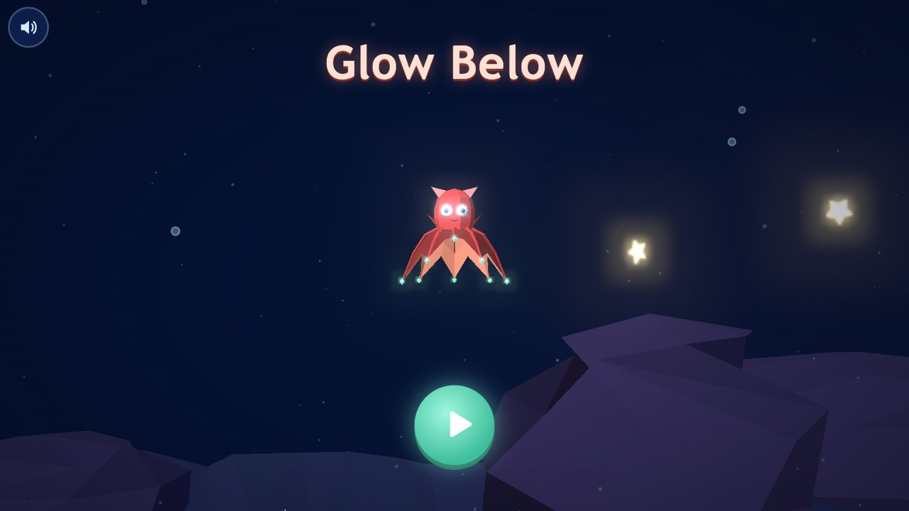
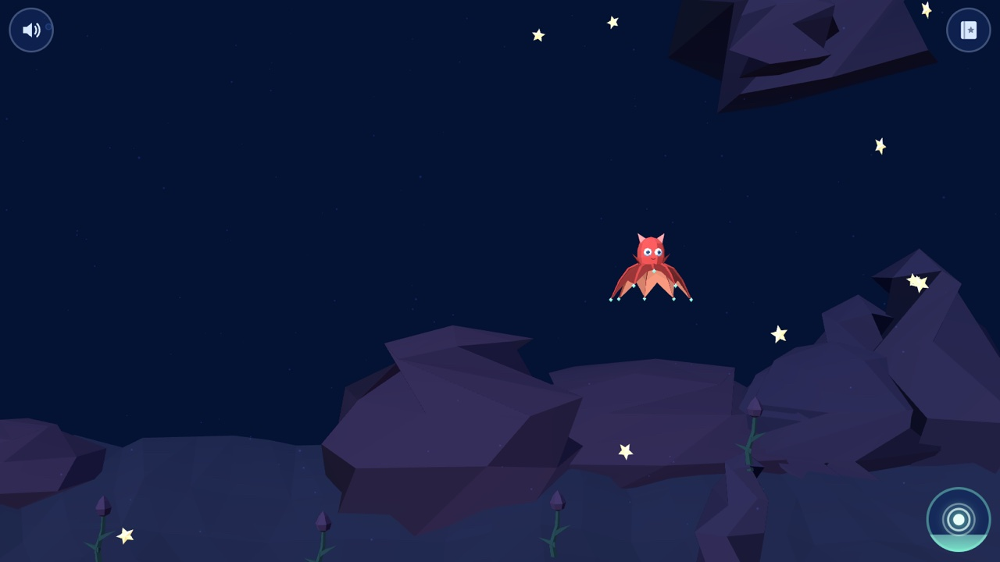
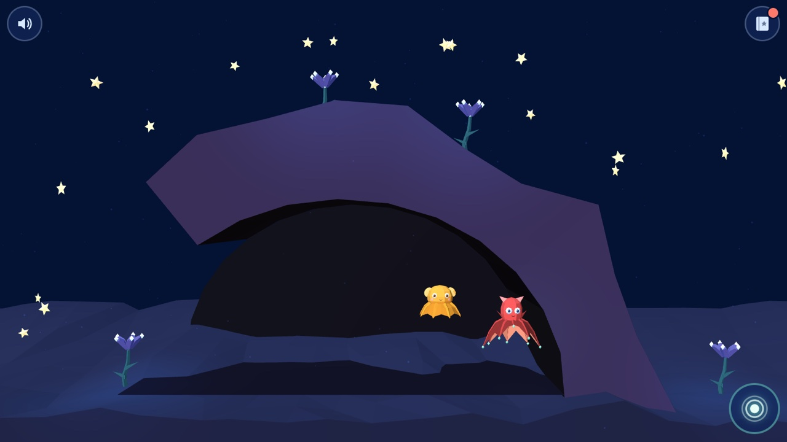
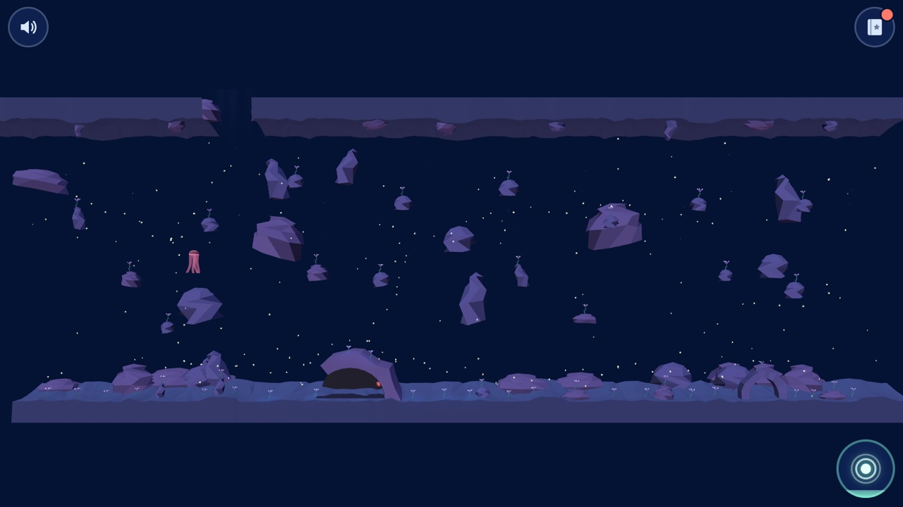
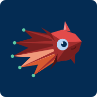
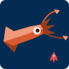

# Glow Below

A cozy, low-poly 3D browser game about a tiny vampire squid exploring the deep sea.
Swim, collect glowing marine snow, light up the dark and make cephalopod friends.



> **Why this exists**
> This is a project made to please my kid 🦑 — and also a playground for me to
> experiment with **agentic development** and **agent orchestration**.
> All of the code, the 3D models and the specs were written by AI agents,
> driven by a spec-first workflow (see [How it is built](#how-it-is-built)).

---

## The game

- Made for a **6-year-old**: no dying, no timers, no reading needed
- **Tablet first** (one finger), fully playable on a laptop (arrow keys + Space)
- **Peaceful sandbox**: every friend helps you, nothing is locked
- Sessions of 5–10 minutes

### Core loop

1. **Swim** around Midnight home
2. **Collect** sparkles (marine snow) → fills the glow meter
3. **Glow** to light up the dark: plants bloom and stay lit
4. **Find a friend** hiding in the zone → a new sticker in the album

| Swimming in the dark                       | Found Dumbo!                                             |
| ------------------------------------------ | -------------------------------------------------------- |
|  |  |

Every world is generated from a seed — here is a whole Midnight home, with the
giant phantom jelly drifting on the left:



### Controls

| Input    | Move                                           | Glow                             |
| -------- | ---------------------------------------------- | -------------------------------- |
| Touch    | Hold a finger; the squid swims toward it       | Tap the squid or the glow button |
| Keyboard | Arrow keys / WASD                              | Space                            |
| Mouse    | Hold the button; the squid follows the pointer | Click the squid                  |

`M` toggles sound.

### Characters

| Hero                                     | Dumbo octopus                                       | Firefly squid                                       | Nautilus                                  | Cuttlefish                                    | Giant squid                                     |
| ---------------------------------------- | --------------------------------------------------- | --------------------------------------------------- | ----------------------------------------- | --------------------------------------------- | ----------------------------------------------- |
|  |  |  |  |  |  |

---

## Getting started

```sh
nvm use          # Node 24, from .nvmrc
npm install
npm run dev      # http://localhost:5173
```

| Command              | What it does                                                    |
| -------------------- | --------------------------------------------------------------- |
| `npm run dev`        | Vite dev server                                                 |
| `npm test`           | Vitest unit tests                                               |
| `npm run build`      | Type-check + production build into `dist/`                      |
| `npm run preview`    | Serve the production build                                      |
| `npm run build:itch` | Build and zip for itch.io into `release/glowbelow-itch.zip`     |
| `just release`       | Test, build and push to itch.io with `butler`; run after each archived iteration |

Useful URL parameters:

- `?seed=123` — play a specific world
- `?debug` — FPS and state overlay; keys `C` colliders, `G` reach, `O` overview, `L` light all plants
- `?nobloom` — turn off bloom on slow devices

---

## How it is built

### Stack

- **TypeScript + Vite + Three.js** — flat-shaded low poly, vertex colours, no textures
- **Web Audio** synth — every sparkle plays a pentatonic note
- **Python scripts** generate every 3D model as `.glb` (no Blender, no hand modelling)

### Project layout

```
src/
  game/      pure game logic (steering, glow meter, pulses, friends) + tests
  levels/    procedural zone generation from a seed + tests
  render/    Three.js views, camera, lights, effects
  ui/ audio/ i18n/
tools/       Python model generators (make_*.py) and a model viewer
models/      generated .glb files
artwork/     SVG concept art and model previews
openspec/    specs and change proposals
GAME_DESIGN.md   the full game design
```

### The agentic workflow

- **Design doc first**: [`GAME_DESIGN.md`](GAME_DESIGN.md) is the source of truth for what the game is
- **Spec-driven changes** with [OpenSpec](https://github.com/Fission-AI/OpenSpec):
  propose → review → apply → archive
  - Living specs in [`openspec/specs/`](openspec/specs)
  - Planned iterations in [`openspec/changes/`](openspec/changes)
- **Claude Code** skills and commands (`.claude/`) drive each step (`/opsx:propose`, `/opsx:apply`, …)
- **Models by script, refined by the agent**: a script builds the mesh → renders a preview →
  the agent inspects it and adjusts → repeat until it matches the concept art
- Game logic is kept pure and unit-tested so agents can change it safely

### Roadmap

- [x] Playable Midnight home: squid, sparkles, glow, Dumbo, procedural zone, phantom jelly
- [ ] Twilight + nautilus elevator + firefly swarm
- [ ] Save + sticker album
- [ ] Whale fall + giant squid, Sunlit reef + cuttlefish
- [ ] Italian translation, offline (PWA), voice-over
