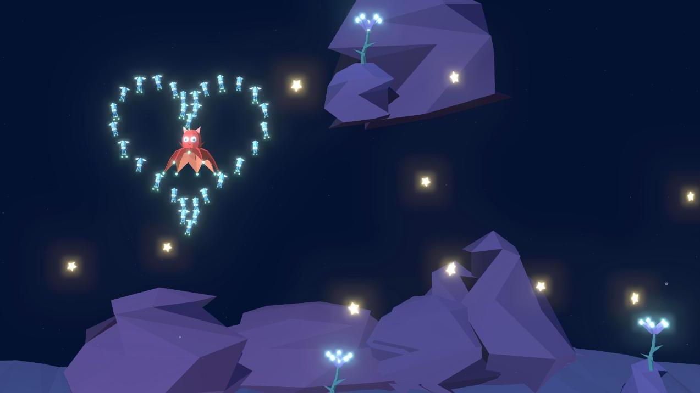
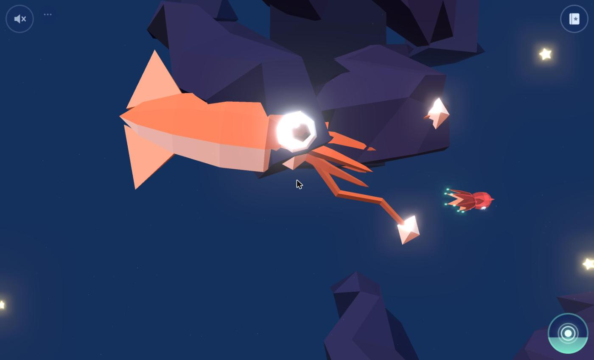
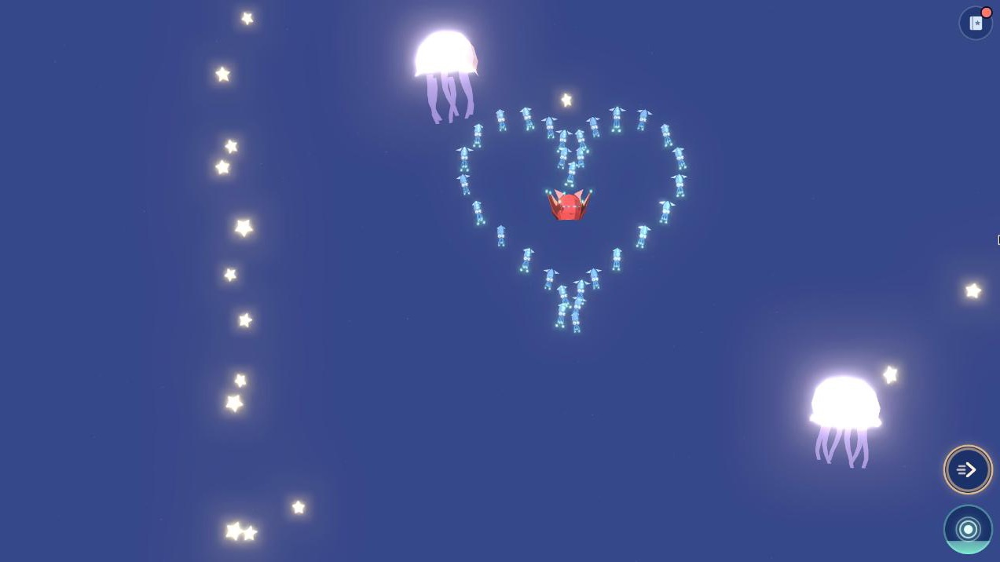
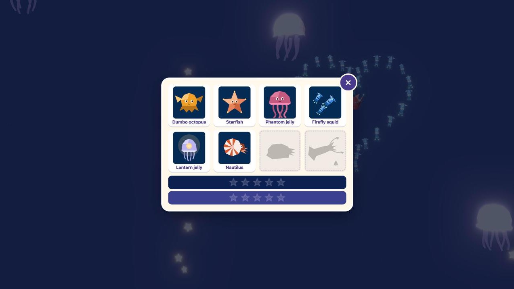

# itch.io page

## Short description (tagline)

The sea is dark and the lanterns are asleep. Wake them with your glow.

## Description

Glow Below is a peaceful little game about a tiny vampire squid in the deep sea, where it is very dark and very quiet. Until you glow.

Swim, catch drifting sparkles and give a pulse of light: sea plants bloom, jellyfish lanterns wake up, and the places you light stay lit. Dart through bubble rings for a burst of speed, and look for the shy starfish that wave back when you glow near them.

You are not alone down here. A dumbo octopus flaps along beside you, a phantom jelly drifts through the dark, a swarm of firefly squid follows you and makes shapes, and a very old nautilus cruises up and down the Twilight waters leaving sparkles behind. Every friend you find goes into a sticker album. Your progress is saved, so you can pick up where you left off.

Beside your home lies Whale fall, where an old whale skeleton rests on the seabed. Glow at its ribs and they play notes like a xylophone; light them all for the whale song. Behind the skull sleeps a giant squid: wake it with a big glow and ride its arm up to the next place you haven't been, all the way to the top of the world.

It is made for young children (around 6): no dying, no timers, nothing lost, no reading needed. Play by touch on a tablet, or with the arrow keys, Space to glow and Shift to dash on a laptop. Every new game is a freshly generated world, and a grown-up corner (hold the button for a moment) holds volume and reset.

**Early version.** More is coming: a sunlit reef at the top of the world, and an Italian translation.

Which friend will you find first?

No ads, no accounts, no links out.

## Tags

cute, relaxing, cozy, family-friendly, ocean, exploration, low-poly, 3d, touch-friendly, procedural-generation (itch.io allows 10; it has no "kids" tag)

## Sidebar

Metadata tab (Classification, Engines & tools):

- Genre: Adventure (edit page)
- Engines & tools: Three.js
- Input methods: Keyboard, Touchscreen
- Average session: A few minutes
- Languages: English only (Italian when it ships; never tick every language)
- Accessibility: Textless
- Accessibility: Textless (itch's "no text" option; no reading needed to play)
- Multiplayer: none

## Indexing checklist

From [itch.io: getting indexed](https://itch.io/docs/creators/getting-indexed) and the [quality guidelines](https://itch.io/docs/creators/quality-guidelines):

- Visibility: Public; Public access settings not "Unlisted in search & browse"
- Cover image uploaded (`cover.jpg`); screenshots uploaded
- Metadata tab filled: genre, inputs, languages, accessibility
- Tags: no synonyms of each other, nothing already covered by metadata
- New pages can wait in a review queue for a few days; don't delete and recreate
- Big updates: post a devlog (it helps ranking); the publish date never changes

## AI disclosure

Short version for the itch.io box (the AI Assisted tag and "Code" are set in the sidebar):

> Glow Below is a learning project in agentic development: Claude Code agents helped across the whole pipeline, from specs to code to release, while I set the direction and test the game. The code, the 3D models (generated by small Python scripts) and the page text were made with AI help; the art direction is mine. There are no audio files: all sound and music are synthesised live by code. Nothing in the game uses AI while you play.

Check before pasting: that the cover art and "art direction is mine" are true.

## Screenshots

In the gallery, in this order (3–5 is itch's sweet spot):

1. `shot-midnight.jpg`
2. `whale-fall-giant-squid.jpg` (from `devlog/`)
3. `shot-twilight-swarm.jpg`
4. `shot-album.jpg`
5. dumbo in the cave (older shot, only on itch.io)

## Theme

Colours taken from the game (Edit theme on the project page):

| Field | Value | From the game |
|---|---|---|
| BG | `#041233` | deep Midnight water, the title screen |
| BG 2 | `#0e1f4d` | a step lighter navy, so the column stands off the page |
| Text | `#f5f8ff` | near-white with a hint of blue, like the sea-plant glow |
| Link | `#5dcaa5` | the squid's teal glow, like the play button |

- Contrast on BG 2: text 14.9:1, links 7.9:1 (both pass WCAG AA)
- Font: Lato, Large (Nunito, the game's font, if itch offers it)

## Settings

- Kind of project: HTML
- Release status: In development
- Pricing: No payments
- Embed: 960×600, mobile friendly (landscape), fullscreen button, click to launch
- Page: https://kajyr.itch.io/glow-below (draft until the first push is checked)
