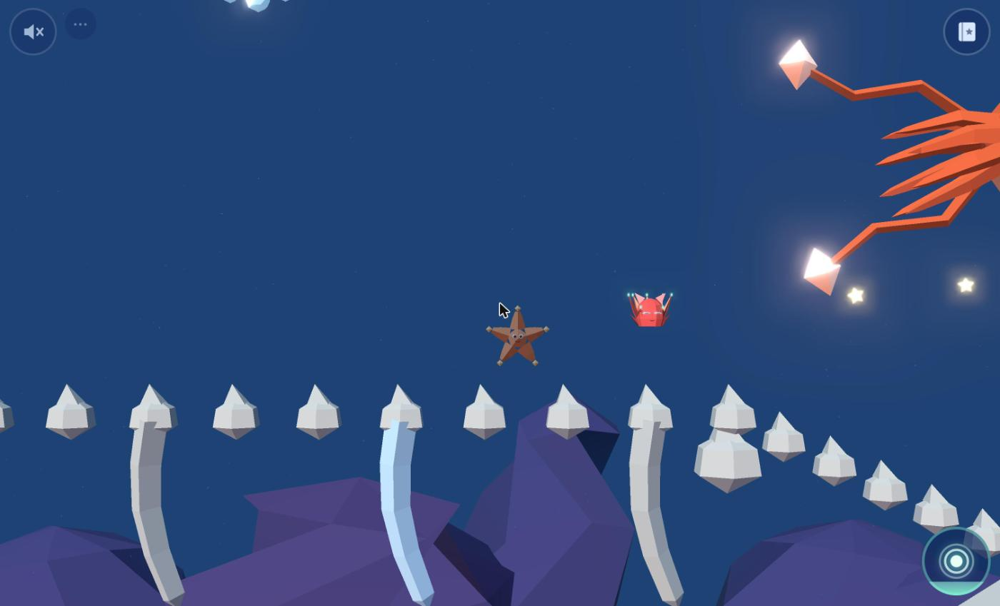
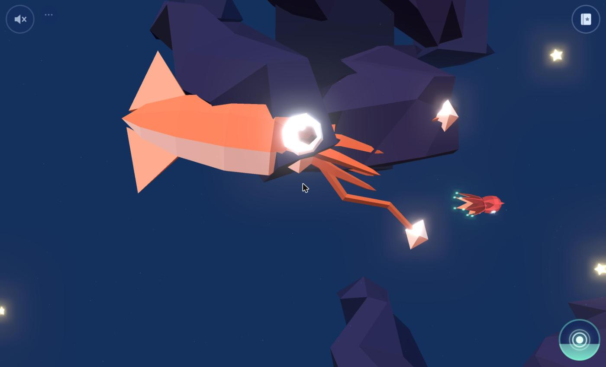

# Whale fall and the giant squid

Glow Below has a new place to explore: **Whale fall**, a quiet room beside the squid's home where an old whale skeleton rests on the seabed.

## What's new

- **Whale fall**, to the left of home. Swim under the ribs, between them and over the spine. Like every zone, it's laid out differently in each new game.
- **Musical ribs.** Glow near a rib and it plays a note, like a xylophone, and stays softly lit. The notes go up from the tail to the head.
- **The whale song.** Light every rib and the whole skeleton glows, sparkles burst out, and the glow meter fills right up. Swim along the ribs from tail to head to hear it again.
- **The giant squid**, the game's biggest friend. It sleeps behind the whale skull. A small glow makes it shuffle in its sleep; a big, full-meter glow wakes it up.
- **Your first ride.** Once awake, the giant squid holds out an arm. Touch the glowing tip and it carries you all the way up to the top of the world. Steer to hop off any time.
- **More to find:** five new starfish, a new bubble-ring chain and a new album page with a fun fact.

## How to ride the giant squid

1. **Fill the glow meter.** Catch sparkles, or light all seven ribs: the whale song fills the meter in one go.
2. **Wake it up.** Swim near the whale skull and glow with a full meter. The giant squid rises above the skull and holds one tentacle down, with a softly glowing tip.
3. **Touch the glowing tip.** The squid climbs on, and the giant squid carries it out of Whale fall, across home, up the shaft and all the way up through Twilight.
4. **At the top**, it sets the squid down gently and swims back to its spot in Whale fall. Swim down whenever you like.

The ride takes about 18 seconds. Steering during the ride hops off right where you are; just swim back to the arm to ride again.

## For grown-ups

- Saved games carry on: Whale fall simply appears, with its ribs dark and the giant squid asleep.
- Still nothing to read and nothing to lose. If the giant squid is hard to find, stop for a moment: the dumbo octopus points at it.

## What's next

For now the ride ends at the top of Twilight, which you can also reach by swimming. Next comes the **Sunlit reef** above it, and the giant squid's arm will be the only way in: swimming up, the water gently turns you back; riding the arm, you go straight through. Leaving is easy: just swim down.
