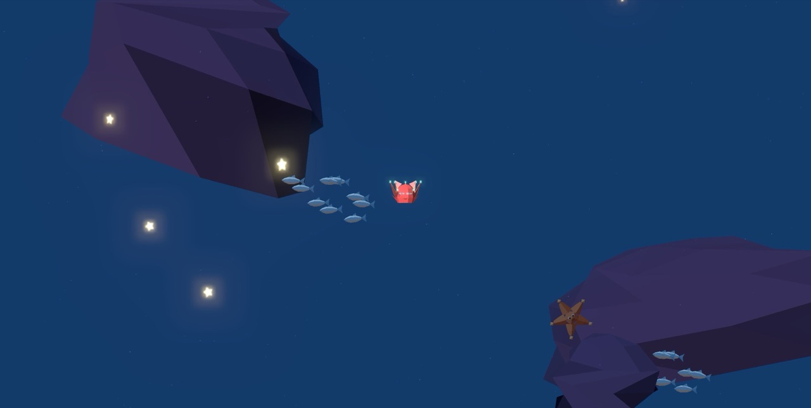

# More fish, a calmer nautilus, and what's next

A small update (0.4.0) after Whale fall: livelier water, a slower ride and a fix for the installed app.

## What's new

- **More fish in Whale fall.** Twice as many schools, and bigger ones: up to six schools of nine fish, drifting between the rocks and over the ribs.
- **A calmer nautilus.** The nautilus elevator now swims a little slower, so the ride up and down feels gentle, not rushed. A round trip takes just over a minute.

## For grown-ups

- **Installed on a tablet?** If you added Glow Below to your home screen from its own web address, it now updates itself: a new version arrives while the game is in the background and is there next time you open it. Progress is kept.
- If your installed copy seems stuck on an old version, close it from the app switcher and open it twice. This is only needed once.
- On itch.io the game always plays the latest version; nothing to do.

## What's next

The **Sunlit reef**, the bright coral garden at the top of the world:

- Only the giant squid's arm takes you up there; swimming down is always open.
- Corals change colour when you touch them, and the squid puts on sunglasses in the bright light.
- A shy **cuttlefish** hides as a coral. Glow to find it, then play its colour game to paint the squid's glow a new colour.
- Swim all the way up to the surface for a little ending: shooting stars and every starfish you've found.
