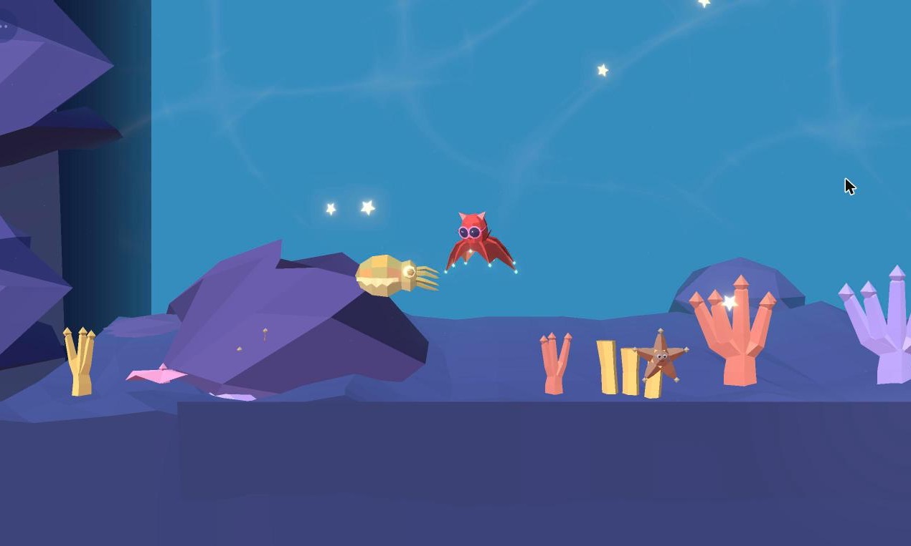
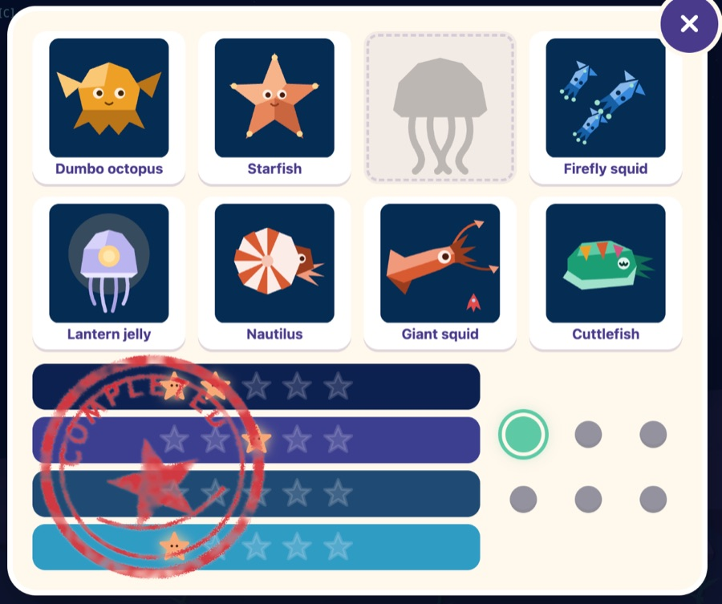

# The Sunlit reef, the cuttlefish and the end of the journey

The top of the world is open: the **Sunlit reef**, a bright coral garden under the sea's surface. It's the last of the first version's four zones, and with the cuttlefish all five friends are in the game.

## What's new

- **The Sunlit reef**, above Twilight. Turquoise water, sunlight dancing over the seabed, cheerful music and a shimmering surface. Like every zone, it's laid out differently in each new game.
- **Only the giant squid goes up there.** Its arm now carries you all the way into the reef. Swimming up Twilight, the reef's light shines through the opening above, but the water gently turns you back. Leaving is easy: just swim down.
- **Sunglasses.** A vampire squid lives in the dark, so in the bright reef it pops on a pair of chunky pink sunglasses.
- **Corals that change colour.** Swim into a coral, or glow at it, and it turns the next colour with a soft chime.
- **The cuttlefish**, the fifth friend. It hides as a coral that now and then flickers a colour that doesn't match. Glow at it to find it.
- **The colour game.** Touch the cuttlefish and it glows a colour: find a coral of that colour. Three rounds, no wrong answers, no timer. If you pick another coral, the cuttlefish just wiggles, and that coral moves to its next colour.
- **New glow colours.** Each finished game paints the squid's glow in the last colour: pink, amber, lavender, coral or sky blue. Switch back any time with the colour dots in the sticker album.
- **The end of the journey.** Somewhere on the reef, a sunbeam pours down through the surface. Swim up into it: the sticker album opens and a big red "completed" stamp thumps onto the page, like a real rubber stamp. It stays there. Close the album and play on.
- **More to find:** five new starfish, a bubble-ring chain and the cuttlefish's album page with a fun fact.

## For grown-ups

- Saved games carry on: the reef appears with its corals in their first colours and the squid's glow still teal.
- The giant squid is the only way into the reef. If it's still asleep, the dumbo octopus points at it in Whale fall.
- The ending takes nothing away: everything found stays found, and you can keep playing to fill the album.
- Still nothing to read and nothing to lose.

## What's next

Italian is next, so the game can be played in Italian too. After that, more friends and new places to explore.
