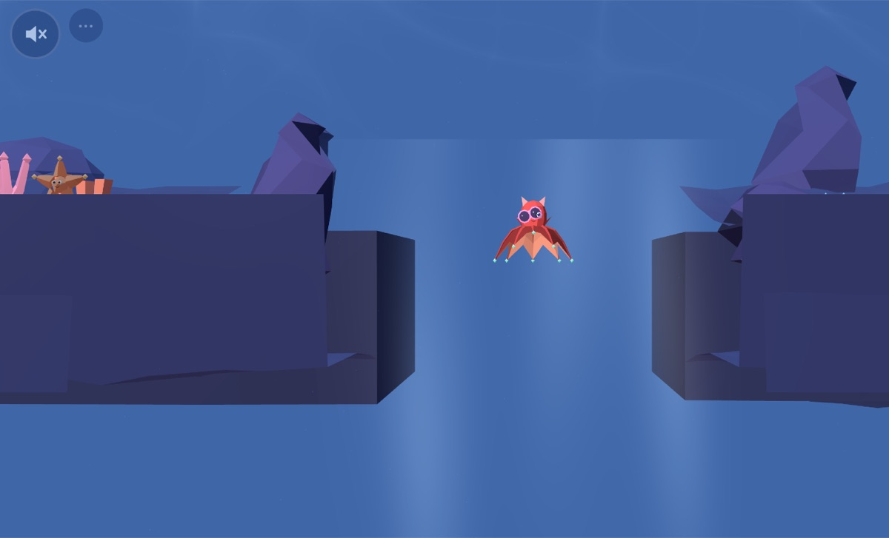

# Swim all the way to the top

The Sunlit reef is open: you can now swim up into it.

## What's new

- **Swim up into the reef.** At the very top of Twilight, follow the light coming down: the opening there now lets you through, straight up into the Sunlit reef. Before, the water turned you back and only the giant squid could take you up.
- **The giant squid is an express lift.** Wake it in Whale fall and ride its arm for a quick trip up: to Twilight the first time, then all the way to the reef. A treat, not a gate.
- Every place in the sea can now be reached just by swimming, from the very first minute.

## For grown-ups

- Saved games carry on as they are.
- Still nothing to read and nothing to lose, and now nothing to unlock before you can go anywhere.

## What's next

Italian is next, so the game can be played in Italian too. After that, more friends and new places to explore.
